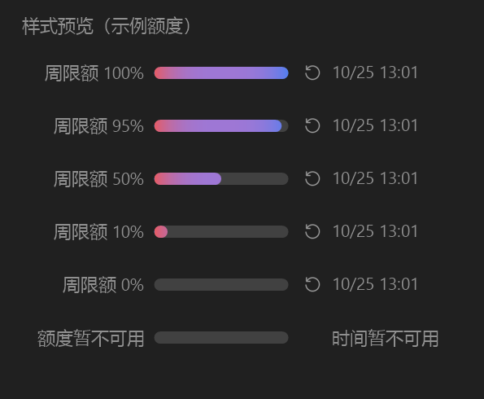

# Codex Usage Bar

**把剩余额度留在标题栏，让注意力留在任务上。**

A compact, native-child usage meter for the **Codex desktop app on Windows**.

[](https://github.com/wutop1an/codex-usage-bar/actions/workflows/build.yml)

[](LICENSE)

[快速开始](#快速开始) · [完整说明](docs/REFERENCE.md) · [架构与开发](docs/ARCHITECTURE.md) · [English](README.en.md)



*示例图：颜色从左侧红色过渡到右侧蓝色。额度消耗时，彩色部分从右向左缩短。*

## 它做什么

Codex Usage Bar 在 Codex 窗口右上角显示额度周期、**剩余百分比**和下一次重置时间。
它通过独立的 Windows 原生子窗口嵌入标题栏区域，随父窗口移动、最小化和遮挡。

- **留在应用里**：不创建桌面置顶悬浮条，不修改 Codex 安装文件。
- **一眼读懂额度**：例如 `周限额 75%` 表示本周期还剩 75%，不是已使用 75%。
- **安静的视觉设计**：Segoe UI、统一灰色文字、左红右蓝的渐变，没有滑块或刻度。
- **真实数据**：读取当前本地 Codex CLI 登录会话的账户限额，兼容单周期与双周期响应。
- **遇到图片预览时让开**：通过只读辅助功能信息识别对话框，隐藏用量条，关闭后短暂淡入。
- **有状态的失败处理**：刷新失败后保留上次结果、置灰并加 `*`；从未读到数据时显示不可用。

这是一个**社区项目**，不是 OpenAI 官方插件。标题栏嵌入依赖 Windows 和 Codex 当前窗口结构；
更新 Codex 后可能需要适配。**macOS / Linux 尚未实现。**

## 快速开始

### 环境

| 项目 | 要求 |
| --- | --- |
| 操作系统 | Windows 11 x64，当前仅在这一平台验证 |
| Codex | Windows 桌面应用，已登录有额度数据的 ChatGPT 账户 |
| CLI | 桌面应用安装的 `codex.exe`；默认自动查找本地安装目录 |
| 运行与构建 | .NET Framework 4.8、Windows PowerShell 5.1 或 PowerShell 7 |
| 权限 | 普通用户即可；应与 Codex 运行在相同用户会话和权限级别 |

无需 Node.js、Python、NuGet 包或独立 .NET SDK。

### 下载可运行版本

前往 [Releases](https://github.com/wutop1an/codex-usage-bar/releases/latest)，下载
`codex-usage-bar-2.2.0-windows-x64.zip`，解压后双击 **`Start.cmd`**。
包内包含正式 exe、完整源码和说明；同页提供 SHA-256 校验文件。

### 下载源码后运行

1. 点击本页 **Code → Download ZIP**，或运行：

   ```powershell
   git clone https://github.com/wutop1an/codex-usage-bar.git
   cd codex-usage-bar
   ```

2. 解压到可写目录，打开并登录 Codex。
3. 双击 **`Start.cmd`**。首次启动自动编译，随后在标题栏显示用量。
4. 停止时双击 **`Stop.cmd`**，或右键用量条 / 系统托盘图标，选择退出。

也可以在 PowerShell 中操作：

```powershell
.\build.ps1
.\start.ps1
.\stop.ps1
```

`Start.cmd` 仅为本次 PowerShell 进程使用 `ExecutionPolicy Bypass`，不修改系统执行策略。
若受组织策略限制，请遵循设备策略；项目不要求关闭系统安全功能。

### 使用方式

| 操作 / 显示 | 含义 |
| --- | --- |
| `周限额 75%` | 周限额剩余 75%；周期名称来自接口实际返回的时长 |
| 红 → 紫 → 蓝 | 左红右蓝的固定渐变，消耗的右侧部分变为中性灰色 |
| `10/25 13:01` | 接口返回的重置时间，转换为电脑本地时区；日期仅为示例 |
| 左键单击 | 刷新额度，连续请求有 10 秒间隔限制 |
| 鼠标停留 | 查看已用、剩余比例和重置时间 |
| 右键 | 刷新或退出 |
| 灰色条 + `*` | 上次成功读取的数据，本次刷新失败或数据已过期 |

默认每两分钟刷新一次。程序不调用模型生成内容，也不估算剩余 token 数。

## 数据与隐私

数据链路是：**本地用量条 → 本地 Codex app-server → Codex 的账户额度接口**。
登录凭据由 Codex 管理。本程序不直接读取 `auth.json`，不上传聊天记录、截图或本机文件，
不带遥测服务。Codex 子进程可能按自己的配置连接 OpenAI 服务。

程序仅在 `%LOCALAPPDATA%\CodexUsageBar\` 写入本机状态和自测结果。
`status.json` 包含当前额度、重置时间、进程与窗口信息，**提交 Issue 前请删去不想公开的字段**。
仓库展示图使用固定的示例数据。

## 支持范围与已知限制

- **Windows 11 x64 / 深色界面**：已进行本地编译、绘制和运行验证。当前匹配桌面应用的
  `ChatGPT.exe` 进程及 `OpenAI.Codex_` 安装路径；其他发行方式可能无法识别。
- **图片预览**：当前版本在本机已人工验证显隐正常、延迟改善。基于辅助功能事件和焦点层级，
  仍受应用版本、焦点状态和系统辅助功能提供程序影响，不保证所有弹窗都被识别。
- **窄窗口**：放不下整组信息时暂时隐藏，避免覆盖菜单和窗口按钮。双周期需要更宽的窗口。
- **macOS / Linux**：不支持；不能把 Windows `.exe` 直接用于 Mac。
- **浅色主题、颜色选择、自动开机启动、语言切换**：尚未实现。
- **账号与计费**：显示本地 CLI 会话的限额，不支持 API Key 账单或逐任务费用统计。
  如果 CLI 与桌面应用使用不同账号，数值会属于 CLI 账号。

## 开发与验证

```powershell
.\build.ps1       # 编译正式版本；不包含自测代码
.\test.ps1        # 编译测试版本并执行断言；无需登录账号
.\package.ps1     # 先构建、测试，再生成 Windows 发布包及 SHA-256
```

自测覆盖额度解析、异常响应、消耗方向、渐变曲线、动画、DPI 绘制、文字对齐与原生子窗口属性。
持续集成在 Windows runner 上执行相同构建与测试。自测不等同于所有 Codex 版本的界面兼容验证。

详细信息：

- [完整使用与参数说明](docs/REFERENCE.md)：每个文件、编译参数、视觉常量、状态字段及故障处理。
- [架构与开发说明](docs/ARCHITECTURE.md)：数据链路、窗口生命周期、绘制与可见性机制。
- [贡献指南](CONTRIBUTING.md) · [版本记录](CHANGELOG.md) · [第三方素材](THIRD_PARTY_NOTICES.md)

## License

项目代码采用 [MIT License](LICENSE)。重置图标来自 Microsoft Fluent UI System Icons，
其 MIT 声明单独保留在 [assets/LICENSE-Fluent.txt](assets/LICENSE-Fluent.txt)。
Codex 和 OpenAI 名称属于其各自权利人；本项目与 OpenAI 无隶属关系。

