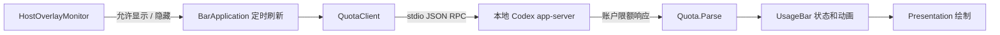

# 架构与开发说明

## 数据流程

## 为什么使用原生子窗口

这个项目需要在 Windows 桌面应用的标题栏位置显示信息。当前实现创建 `WS_CHILD` 控件，
实际父窗口就是 Codex HWND；使用 `WS_EX_LAYERED` 让它在 Electron 的窗口合成方式下正常绘制，
使用 `WS_EX_NOACTIVATE` 避免夺取输入焦点。没有桌面置顶标志，也不修改安装包。

这是一种外部适配，不是受支持的官方标题栏插件 API。
[官方扩展文档](https://developers.openai.com/plugins/build/extensions) 可用于了解正式扩展能力，
不要把这里的 Win32 实现当成跨平台扩展接口。

原生子窗口和网页对话框不共享 DOM 的 z-index。图片预览等网页层可能被子窗口覆盖，
因此必须在检测到对话框时隐藏控件。单纯把窗口改成“非置顶”不能解决这类覆盖。

## 线程与生命周期

- **WinForms 主线程**：管理托盘、控件、布局和绘制。100 ms 计时器检查状态，只有必要时重绘。
- **每个宿主的 MTA 后台线程**：读取 UI Automation 元数据。焦点变化、窗口开关事件唤醒检查，
  350 ms 轮询兜底。读取焦点祖先，最多 40 层，不扫描完整会话树。
- **异步 RPC**：读取重定向的标准输出；请求互斥，25 秒超时。退出只终止本程序持有的子进程。
- **动画计时器**：额度变化或重新显示时才运行。淡入结束、额度插值结束后停止。

宿主窗口每三秒重新发现一次。窗口消失后释放对应控件和监视器。程序保持运行时可重新发现
匹配的新窗口；退出程序之后不会自行开机启动。

## RPC 协议与账号

`QuotaClient` 默认在 `%LOCALAPPDATA%\OpenAI\Codex\bin\*\codex.exe` 中选择最后修改时间最新的 CLI。
启动参数是 `app-server --stdio`，依次执行：

1. `initialize`，携带本项目名称和版本。
2. 等待 id=0 的成功响应。
3. 发出 `initialized` 通知。
4. 发出 id=1 的 `account/rateLimits/read`，只处理对应响应。
5. 解析限额，关闭自己启动的 app-server。

未匹配的通知被忽略；stderr 被排空但不保存；错误只记录类型。
凭据、网络路由及账户状态由本地 Codex CLI 管理。不同登录环境不保证对应同一账户。
接口或 CLI 参数变化时可能需要更新适配器。

## 数据模型与容错

`UsageWindow` 保存已用比例、周期分钟数和可空的重置时间；`UsageBucket` 是一组限额；
`Quota` 持有多组限额及成功读取时间。

解析优先使用 `rateLimitsByLimitId`；缺少或空映射时回退到旧 `rateLimits`。
只接受合法数值：缺失、布尔值、NaN、Infinity、非正周期均不生成额度窗口。
比例被限制在 0–100，时间必须处于可表示的 Unix 日期范围内。
格式错误的整个响应会作为刷新失败处理。没有数据和 0% 使用是两个不同状态。

刷新失败时沿用内存中的上次有效结果，标为旧数据。程序不从 `status.json` 重新加载额度。

## 可见性机制

`HostOverlayMonitor` 发布不可变快照：状态、时间戳、查询耗时。
窗口打开事件先发布 `dialog`，再唤醒后台查询。版本计数避免进行中的旧查询覆盖新的打开事件。

检查从 `AutomationElement.FocusedElement` 向上走到宿主 HWND：

- 祖先存在可见的 Window / dialog / 对话框时，发布 `dialog`。
- 兼容旧 Chromium：名称为 Image preview / 图片预览 / 图像预览的 Pane 也视为对话框。
- 到达宿主且没有对话框时，发布 `clear`。
- 无法到达宿主时为 `checking`；提供程序异常时为 `unavailable`。

事件订阅不被提供程序支持时，继续使用轮询后备路径。
不读取编辑内容，不执行点击或按键，也不记录辅助功能树。
只有最近三秒内的 `clear` 允许显示。后台窗口保留最近状态，回到前台后重新检查。

检测到遮挡后直接隐藏；恢复时通过原生窗口 alpha 做 180 ms 淡入。
这不是把几秒等待包装成动画：焦点层级检查取代了旧版完整树扫描。
不过提供程序自身可能阻塞，固定轮询值不等于端到端延迟保证。

## 绘制与动画

`Presentation` 只接收状态并绘制，不负责查询账户或控制其他窗口。
采用 Windows Segoe UI 和系统中文回退字体，按实际字形像素边界而不是字体框对齐。
缓存最多 128 张短文本位图；满时释放后重建。图片预览图由同一绘制函数离屏生成。

渐变坐标固定在全长轨道上，剩余比例只决定填充范围。这样消耗后保留下来的区域自然由蓝紫
逐渐走向红色。`UsageTransition` 使用 420 ms 三次 ease-out；首条结果直接显示，相同结果
不重新启动动画。`RevealTransition` 单独负责淡入。两者均遵循系统客户端区域动画开关。

## 测试与发布

正式构建不包含 `tests/Tests.cs`；测试构建定义 `TEST_BUILD`，增加自测和预览入口。
所有测试数据是人工构造的，原生子窗口测试只使用测试进程自己的离屏 Form，
不操作真实 Codex 窗口或发送账户请求。

自动化覆盖解析、曲线、消耗方向、动画边界、100%/125%/150%/200% 字形对齐及 WS_CHILD 属性。
真实应用的图片预览、弹窗、缩放、遮挡和升级兼容仍需要人工验证。

发布包按明确文件清单组成，包含源文件、正式 exe、文档、许可证与图标；不复制本机状态、
历史原型、测试 exe、登录文件或个人截图。GitHub Actions 提供同样的构建、测试和 ZIP artifact。

## 后续工作

可选颜色、浅色主题和国际化需要完整的产品设计与验证。macOS 需要单独的原生窗口适配，
不能照搬 HWND、WinForms 或 Windows UIA。本仓库没有把这些内容标成已实现功能。
